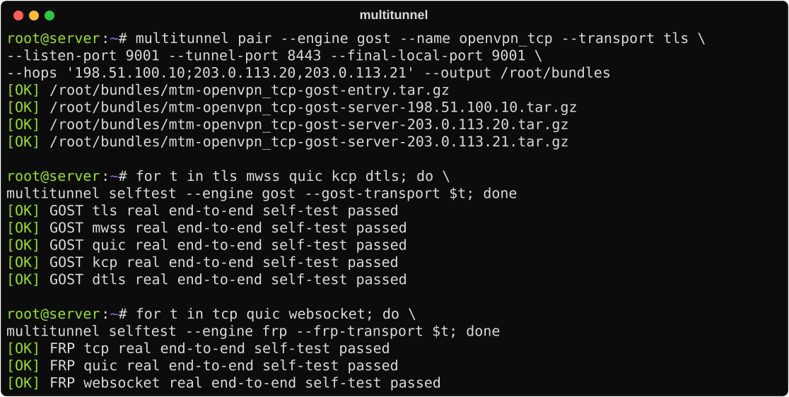
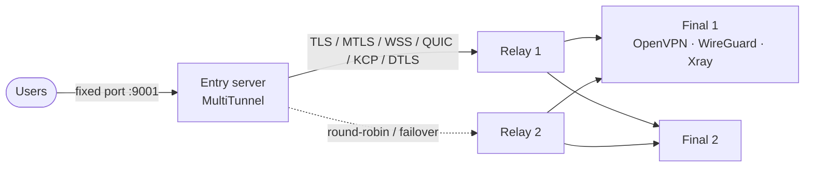
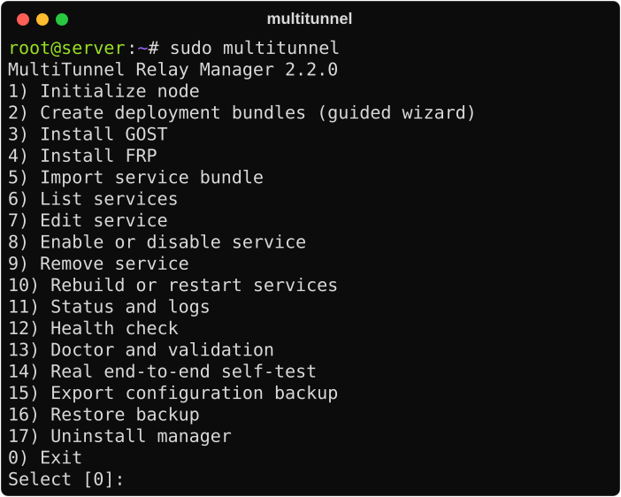
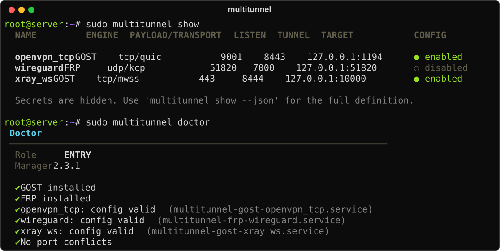

# MultiTunnel Relay Manager

A command-line manager for building and running encrypted TCP/UDP tunnels between an **entry server** and one or more **relay** and **final** servers, using [GOST v3](https://github.com/go-gost/gost) or [FRP](https://github.com/fatedier/frp) as the transport engine.

It sits in front of your existing service (OpenVPN, WireGuard, Xray, or anything else) and only manages the path between servers. Users keep connecting to the same port on the entry server; you can change the route behind it without touching client configs.

```text
user → fixed port on entry server → MultiTunnel → relay(s) → final server → OpenVPN / WireGuard / Xray
```

<p align="center">
  
</p>

## Architecture



Each deployment has its own private CA. Every server receives a bundle with only its own certificate and key, and each service runs as a separate hardened systemd unit.

## Highlights

- **Two engines, many transports.** GOST (TLS, multiplexed TLS, WSS, multiplexed WSS, QUIC, encrypted KCP, DTLS) and FRP (TCP, KCP, QUIC and WebSocket, all with mutual TLS).
- **Multi-hop and pools.** Chain several GOST relays, with several servers per hop using round-robin and failover. FRP supports load-balanced final pools with health checks.
- **Private PKI per deployment.** Each deployment gets its own CA. Every GOST server gets its own certificate with exact IP/DNS SANs, and FRP uses mutual TLS.
- **Deployment bundles.** One command generates a checksummed bundle for each server. Copy it over and import it, with no manual config editing.
- **Safe changes.** Every config is validated with the real GOST/FRP binary before restart. A snapshot is taken before each rebuild, and a failed restart rolls back automatically.
- **Real end-to-end self-test.** It launches both ends of the tunnel locally and pushes random data through it.
- **Hardened services.** One systemd unit per service, a dedicated unprivileged `mtunnel` user, systemd sandboxing and `0600` private keys.
- **Pinned engine downloads.** Official GOST/FRP releases are verified against pinned SHA256 checksums before installation.
- **Interactive menu** with a guided wizard, plus a full CLI for scripting. Colored output and status badges on interactive terminals, plain `[OK]`/`[ERR]` tags when piped or logged.

## Requirements

- Debian or Ubuntu with systemd
- Python 3.8+ and OpenSSL
- Root access

## Install

On every server:

```bash
git clone https://github.com/javadkhammari/multitunnel.git
cd multitunnel
sudo ./install.sh
```

Initialize each server with its role:

```bash
sudo multitunnel init --role entry   # public entry point users connect to
sudo multitunnel init --role relay   # optional GOST relay in the middle
sudo multitunnel init --role final   # server that runs the real service
```

Install the engine you plan to use:

```bash
sudo multitunnel install-engine gost
sudo multitunnel install-engine frp
```

## Interactive menu

```bash
sudo multitunnel
```

<p align="center">
  
</p>

The header shows the node role, installed engines and how many services are running. The menu switches to a single column on narrow terminals (for example, SSH from a phone).

The wizard (option 2) has presets for OpenVPN TCP, OpenVPN UDP, WireGuard, Xray and custom services. It walks you through engine, transport, ports, destination and server pool, then shows a summary before generating anything.

## Example: GOST

OpenVPN TCP listening on port `9001` of the entry server, forwarded over QUIC to a final server where OpenVPN listens on `127.0.0.1:9001`:

```bash
multitunnel pair \
  --engine gost \
  --name openvpn_tcp \
  --payload tcp \
  --transport quic \
  --listen-port 9001 \
  --tunnel-port 8443 \
  --final-local-ip 127.0.0.1 \
  --final-local-port 9001 \
  --hops 203.0.113.50 \
  --output /root
```

This creates one bundle per server:

```text
mtm-openvpn_tcp-gost-entry.tar.gz
mtm-openvpn_tcp-gost-server-203.0.113.50.tar.gz
```

Import each bundle on its own server:

```bash
sudo multitunnel import-bundle /root/mtm-openvpn_tcp-gost-entry.tar.gz                   # entry
sudo multitunnel import-bundle /root/mtm-openvpn_tcp-gost-server-203.0.113.50.tar.gz     # final
```

The OpenVPN client config doesn't change:

```conf
remote ENTRY_SERVER_IP 9001
proto tcp-client
```

### Final pool (single hop)

```bash
--hops 'FINAL1,FINAL2,FINAL3'
```

Each host gets its own bundle, which must be imported only on that host.

### Multi-hop chain

Relays plus a final pool, separated by `;`:

```bash
--hops 'RELAY1,RELAY2;FINAL1,FINAL2'
```

Multi-hop works with the TCP-based transports (`tls`, `mtls`, `wss`, `mwss`). QUIC, KCP and DTLS are single-hop only, and the manager refuses to build a multi-hop chain with them. All servers in a deployment share one CA and secret, but each server has its own TLS private key.

## Example: FRP

With FRP the final server opens the control connection to the entry server, so the final server needs no open inbound port:

```bash
multitunnel pair \
  --engine frp \
  --name openvpn_tcp \
  --payload tcp \
  --transport quic \
  --listen-port 9001 \
  --tunnel-port 8443 \
  --entry-host ENTRY_SERVER_IP \
  --final-local-ip 127.0.0.1 \
  --final-local-port 9001 \
  --load-balance \
  --output /root
```

```text
mtm-openvpn_tcp-frp-entry.tar.gz   → import on the entry server
mtm-openvpn_tcp-frp-final.tar.gz   → import on the final server(s)
```

With `--load-balance` you can import the same final bundle on several final servers. They must all run the same local service on the same port.

## Choosing a transport

| Goal | Transports |
|---|---|
| OpenVPN TCP without TCP-over-TCP | GOST `quic`, `kcp`, `dtls` · FRP `quic`, `kcp` |
| Traffic that looks like web traffic | GOST `wss`, `mwss` |
| Stable TCP path | GOST `tls`, `mtls` · FRP `tcp` with mutual TLS |
| High-latency or lossy path with many users | GOST `mtls` or `mwss` with `--mux-sessions 4` (or more) |
| Xray | `--payload tcp` or `--payload udp` to match the inbound. Set `--final-local-port` to the port Xray listens on. |

**Mux sessions.** `mtls` and `mwss` multiplex many user connections over one TCP connection, which makes new connections fast. On long, lossy routes a single TCP connection has a low speed ceiling, so the entry node can keep several multiplexed connections in parallel:

```bash
multitunnel edit NAME --mux-sessions 4    # run on the entry node
```

New `mtls`/`mwss` services use 4 sessions by default.

FRP `wss` is not offered on purpose. frps cannot terminate WSS on its own port without an external TLS reverse proxy, so FRP uses `websocket` with mutual TLS instead.

## Self-test

After installing an engine, run a real local test. It starts both tunnel endpoints with the actual binaries and sends 32 KB of random data through them:

```bash
sudo multitunnel selftest --engine gost --gost-transport quic
sudo multitunnel selftest --engine frp --frp-transport tcp
sudo multitunnel selftest --engine all
```

## Day-to-day commands

<p align="center">
  
</p>

```bash
sudo multitunnel show            # table view, secrets hidden
sudo multitunnel show --json     # full definitions, including secrets
sudo multitunnel status
sudo multitunnel health
sudo multitunnel doctor
sudo multitunnel rebuild
sudo multitunnel disable openvpn_tcp
sudo multitunnel enable openvpn_tcp
sudo multitunnel edit openvpn_tcp --tunnel-port 9443
sudo multitunnel logs openvpn_tcp --follow
sudo multitunnel remove openvpn_tcp
```

## Backup and restore

```bash
sudo multitunnel export /root/multitunnel-backup.tar.gz     # portable backup with SHA256 manifest
sudo multitunnel restore-export /root/multitunnel-backup.tar.gz
sudo multitunnel list-backups                                # automatic snapshots
sudo multitunnel restore SNAPSHOT_NAME
```

A backup is restored only if every checksum matches. If the restore fails, the manager rolls back to a safety snapshot it takes first.

## Firewall

GOST: open the tunnel port on relay and final servers:

```bash
ufw allow 8443/tcp   # tls, mtls, wss, mwss
ufw allow 8443/udp   # quic, kcp, dtls
```

FRP: open the tunnel port on the entry server.

On the entry server, also open the public listen port:

```bash
ufw allow 9001/tcp
```

## Output and colors

Colors and Unicode symbols are used only on an interactive UTF-8 terminal.

```bash
NO_COLOR=1 multitunnel status    # disable colors
MTM_ASCII=1 multitunnel          # ASCII-only symbols for terminals without Unicode
```

## Files

```text
/etc/multitunnel-manager            state, services, generated configs, PKI, backups
/opt/multitunnel/bin                GOST / FRP binaries
/etc/systemd/system/multitunnel-*   one unit per service
```

## Uninstall

```bash
sudo multitunnel uninstall           # keep configs and keys
sudo multitunnel uninstall --purge   # remove engines, configs and PKI
```

## Limitations

- The self-test checks the software and the configs. It does not measure the real network path. Test latency, loss and throughput between your servers with `iperf3` and a long-running test.
- QUIC and KCP only help when the UDP path is reasonably clean in both directions.
- OpenVPN TCP over a TCP-based transport can still show TCP-over-TCP effects.
- TLS-based transports encrypt traffic, but no transport is guaranteed to be undetectable by every DPI system.

See [SECURITY.md](SECURITY.md) for how to handle bundles and backups.

## License

MIT. See [LICENSE](LICENSE).
